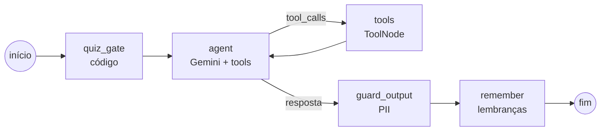
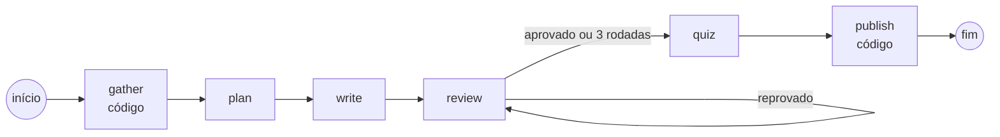

# onboarding-agents-langgraph

**O mesmo onboarding multiagente do [onboarding-agents](../onboarding-agents), reescrito em
LangGraph.** Um Tutor que ensina e acompanha cada colaborador e um Curador que prepara os
materiais, sempre com revisão humana.


> **O que mudou em relação à versão ADK, e por quê:**
> [docs/MIGRACAO-ADK-LANGGRAPH.md](docs/MIGRACAO-ADK-LANGGRAPH.md)

---

## Os dois grafos

**Tutor**



**Curador**



**Persistência (SQLite em `.lg/`):**

| Arquivo | O quê | Componente |
|---|---|---|
| `checkpoints.db` | Conversas (uma thread por conversa) | `SqliteSaver` |
| `store.db` | Perfil/progresso e lembranças, por usuário | `SqliteStore` |
| `catalog.db` | Materiais, perguntas, lacunas, pedidos, buddies (**mesmo formato da versão ADK**) | `storage.Catalog` |

---

## Começando

```bash
make setup          # .venv, dependências, modelo pt do spaCy e .env de exemplo
make test           # testes sem chamar o modelo
make check          # papéis e base de conhecimento
```

Configure o `.env` (Vertex AI ou `GOOGLE_API_KEY`), como na versão ADK.

**Materiais:** gere com o Curador LangGraph ou reaproveite o catálogo da versão ADK, que tem o mesmo
formato:

```bash
mkdir -p .lg && sqlite3 ../onboarding-agents/.adk/catalog.db ".backup .lg/catalog.db"
```

Ou gere um módulo do zero:

```bash
.venv/bin/python scripts/curate_role.py dev_salesforce --module seguranca_informacao
.venv/bin/python scripts/approve.py list
```

**Converse com o Tutor:**

```bash
make chat USER_ID=seu.login
```

---

## Comandos

Os mesmos da versão ADK, com estas diferenças:

| Versão ADK | Esta versão |
|---|---|
| `make web` (`adk web`) | `make studio` (LangGraph Studio; requer `pip install -e ".[studio]"`) |
| `make eval` / `make eval-report` (`adk eval`) | `make eval` (harness próprio; relatório em `evals/.fixture/report.json`) |
| Dados em `.adk/` | Dados em `.lg/` |

Revisão (`scripts/approve.py`), buddy (`scripts/buddy.py`), visão geral (`make inbox`), dados
pessoais (`scripts/user_data.py`) e backup funcionam igual. Os guias por persona do projeto
original valem para esta versão:
[responsável](../onboarding-agents/docs/1-responsavel-pelo-piloto.md),
[autor](../onboarding-agents/docs/2-autor-de-conteudo.md),
[revisor](../onboarding-agents/docs/3-revisor.md),
[buddy](../onboarding-agents/docs/4-buddy.md),
[tutorado](../onboarding-agents/docs/5-tutorado.md).

---

## Estrutura

```
src/onboarding_lg/
  tutor/graph.py        grafo do Tutor (quiz_gate, agent, tools, guard_output, remember)
  curator/graph.py      grafo do Curador (gather, plan, write, review, quiz, publish)
  tools/tutor_tools.py  tools com ToolRuntime (store, context, state)
  profile.py memory.py  perfil e lembranças no Store
  services.py           checkpointer + store em SQLite, threads, streaming
  guardrails.py         PII na fronteira e na saída
  studio.py             entradas para o LangGraph Studio
  progress.py quiz_view.py prompts.py config.py db.py reports.py
  schemas.py roles.py kb.py pii.py quiz_bank.py storage.py   ← iguais à versão ADK
scripts/                chat, curate_role, approve, buddy, inbox, user_data, check_content, ...
evals/run_evals.py      os 11 casos da versão ADK, com LLM juiz
langgraph.json          configuração do LangGraph Studio
```

## Limitações

As mesmas da versão ADK (sem login, sem notificações, busca por palavra-chave, uma instância só),
mais uma: **no LangGraph Studio a entrada não é mascarada** (a máscara de PII fica na fronteira usada
pelo chat e pelos evals). Use o Studio só com dados de teste.
