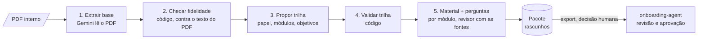

# onboarding-curator

**O Curador do [onboarding-agent](../onboarding-agent) como agente isolado: você entrega um PDF
interno e ele gera a base de conhecimento, a trilha do papel e os materiais com banco de perguntas,
tudo como rascunho para revisão humana.**


---

## O que ele faz



| Etapa | Como | Resultado |
|---|---|---|
| 1. Extrair a base | O Gemini lê o PDF inteiro (inclusive tabelas e páginas escaneadas), com regras de fidelidade: não acrescentar, manter a força das regras, manter números, sujeito explícito, sem dados pessoais | `kb/*.md` no formato do onboarding-agent |
| 2. Checar fidelidade | **Código, sem LLM:** cada seção é comparada com o texto do PDF (vocabulário, números e palavras de regra que o PDF não tem) | Seções suspeitas no relatório |
| 3. Propor a trilha | O Gemini monta os módulos (objetivos verificáveis, tags, pré-requisitos) para o papel informado | `roles/<papel>.yaml` |
| 4. Validar a trilha | **Código:** ids, tags que existem na base, pré-requisitos em ordem, módulos sem cobertura descartados | Avisos no relatório |
| 5. Gerar materiais | Planejar, escrever, **revisar contra os trechos originais** (até 3 rodadas) e criar 5 a 6 perguntas | Rascunhos no `catalog.db` |

**Nada é aprovado automaticamente.** O pacote vai para o onboarding-agent como rascunho, e lá o
revisor aprova cada material ([guia do revisor](../onboarding-agent/docs/3-revisor.md)).

---

## Começando

```bash
make setup          # .venv, dependências e .env de exemplo
make test           # testes sem chamar o modelo
make sample         # gera examples/manual-qa.pdf (manual fictício para teste)
```

Configure o `.env` (Vertex AI ou `GOOGLE_API_KEY`), como no onboarding-agent.

### Importar um PDF (linha de comando)

```bash
.venv/bin/python scripts/import_pdf.py examples/manual-qa.pdf \
    --role-id analista_qa --role-title "Analista de QA" \
    --role-hint "testa as entregas Salesforce antes de irem para produção" \
    --buddy-contact "#onboarding-qa no Slack"
```

Use `--skip-materials` para gerar só a base e a trilha, em ~2 minutos, e revisar antes de gastar
com os materiais.

O pacote sai em `out/<papel>-<data-hora>/`:

| Arquivo | Conteúdo |
|---|---|
| `relatorio.md` | **Comece por aqui:** o que foi gerado e o que precisa de revisão humana |
| `kb/*.md` | Base de conhecimento extraída |
| `roles/<papel>.yaml` | Trilha proposta |
| `catalog.db` | Materiais + bancos de perguntas (rascunhos) |
| `manifest.json` | Metadados: PDF de origem, modelo, checagens, resultados |

### Levar para o onboarding-agent

Depois de revisar a base e a trilha no pacote:

```bash
.venv/bin/python scripts/export_package.py out/analista_qa-<data-hora> ../onboarding-agent
```

- Copia `kb/*.md` para `data/kb/` e o YAML para `data/roles/`. **Recusa sobrescrever** arquivos
  existentes, a menos que você passe `--force`.
- Importa os materiais no catálogo do onboarding-agent **como rascunho**, com a nota "importado do
  onboarding-curator".
- No onboarding-agent: reinicie `make web`/`make chat`, rode `make check` e aprove os rascunhos com
  `scripts/approve.py`.

### Conversar com o Curador (agente)

```bash
cp examples/manual-qa.pdf inbox/
make web            # adk web: escolha "curador"
```

Peça, por exemplo: *"importe o manual-qa.pdf para o papel Analista de QA"*. Ele confirma o que
falta (role_id, nome do papel), avisa que leva alguns minutos, importa e resume o que precisa de
revisão. A exportação **não** é uma tool do agente, de propósito: ela altera outro projeto e deve
ser uma decisão humana.

### Como agente isolado (A2A)

```bash
make a2a            # http://localhost:8001, agent card em /.well-known/agent-card.json
```

Qualquer agente compatível com A2A pode pedir uma importação pela rede. No ADK:

```python
from google.adk.agents.remote_a2a_agent import RemoteA2aAgent

curador = RemoteA2aAgent(
    name="curador",
    agent_card="http://localhost:8001/.well-known/agent-card.json",
)
```

---

## Resultados com o PDF de exemplo

O `examples/manual-qa.pdf` é um manual **fictício** de 2 páginas, com armadilhas de propósito.
Resultado medido com `gemini-2.5-flash` via Vertex AI:

| Armadilha no PDF | O que saiu na base |
|---|---|
| "Testes **nunca** podem ser executados em produção" | Mantido com "nunca" |
| "É **obrigatório** criar um teste automatizado para todo bug de severidade alta" | Mantido com "obrigatório" |
| Daily às 9h45, suíte às 22h, prazo de 2 dias úteis, ramal 4500 | Números iguais |
| Tabela severidade × prazo | Frases autocontidas, uma por severidade |
| "Carla Mendes, tech lead de QA" (nome de pessoa) | "a tech lead de QA" |
| `seguranca@exemplo.com` (contato oficial) | Mantido |

| Métrica | Valor |
|---|---|
| Base | 3 documentos, 11 seções; 11/11 sustentadas pela checagem automática |
| Trilha | 5 módulos; 2 avisos (tags removidas por não existirem na base) |
| Materiais | 5/5 gerados, todos aprovados pela revisão automática, todas as fontes válidas |
| Exportação | `make check` do onboarding-agent passou e os 5 rascunhos apareceram para aprovação |
| Tempo | ~2 min só base e trilha; ~11 min com os 5 materiais |

**O que a revisão humana ainda precisa olhar:**
- O extrator às vezes troca o imperativo do PDF ("abra um chamado") por "o analista **deve**
  abrir", um leve endurecimento que a checagem automática não pega.
- O revisor automático rigoroso deixa o texto fiel, mas às vezes **robótico** ("Jira é uma
  ferramenta de acesso necessário"). Fidelidade e fluência competem; ajuste no `edit`.

---

## Limitações

- **PDF de até 20 MB** (envio inline ao Gemini). Para arquivos maiores, use a Files API ou o GCS.
- **PDF escaneado:** o Gemini lê, mas a checagem automática de fidelidade fica indisponível (não
  há texto para comparar). O relatório avisa.
- A checagem de fidelidade é por vocabulário: **pega invenções grosseiras, não prova
  fidelidade**. Ela não percebe, por exemplo, uma troca de sujeito com as mesmas palavras.
- **Lento:** os módulos são gerados em sequência. Dá para paralelizar, mas a cota do Vertex limita.
- O agente conversacional espera a importação inteira na mesma chamada (minutos). Para uso real,
  a importação deveria virar um job em segundo plano.

## Estrutura

```
src/curator_agent/
  ingest.py      etapas 1-2: extração do PDF e checagem de fidelidade
  trail.py       etapas 3-4: proposta e validação da trilha
  materials.py   etapa 5: material + perguntas (revisor com as fontes)
  package.py     pipeline completo, relatório e exportação
  agent.py       agente ADK (tools) para adk web e A2A
  kb.py pdf.py llm.py prompts.py config.py
  schemas.py storage.py quiz_bank.py   ← mesmo formato do onboarding-agent
agents/curador/  entrypoint do adk web
scripts/         import_pdf, export_package, serve_a2a, make_sample_pdf
examples/        manual-qa.pdf (fictício)
```
